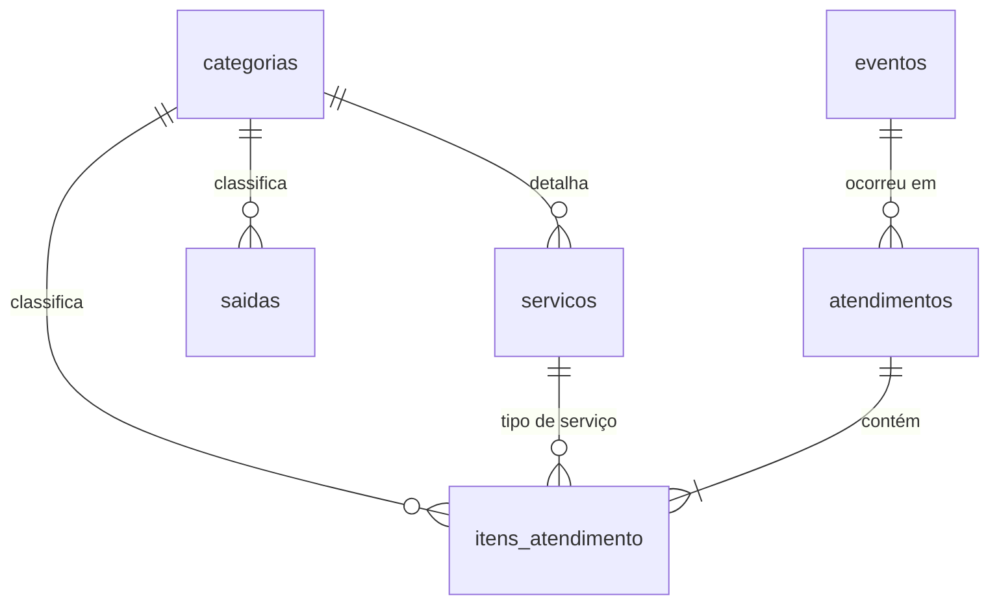

# Controle financeiro para um studio de perfuração

Aplicação web para controlar entradas, saídas e lucro de um studio de perfuração, feita para ser usada pelo celular. O projeto nasceu de uma necessidade real: a dona do studio controlava as finanças em um caderno, com pouca precisão e difícil acesso.

> **Status:** em desenvolvimento.

## O problema

Levantei os requisitos em conversa com a cliente. As principais reclamações eram:

- anotações no caderno, feitas só quando dava, com imprecisão;
- dificuldade de consultar rapidamente quanto entrou, quanto saiu e qual o lucro;
- falta de visibilidade sobre quais serviços dão mais retorno.

Também mapeei como o negócio funciona, e isso moldou o sistema:

- **Entradas:** perfurações (vários tipos), lobuloplastia, venda de joias e eventos pontuais em parceria com uma loja de joias.
- **Formas de pagamento:** Pix, dinheiro e cartão. Na maquininha, a taxa varia e é descontada do valor recebido.
- **Saídas:** material descartável, compra de joias, alimentação da recepção, funcionária (valor fixo mais comissão), gestão de anúncios, anúncios patrocinados, água e luz.
- **Uso:** a atualização é feita ao fim do dia, de preferência pelo celular, por uma única pessoa.

## Funcionalidades

- [x] Resumo do mês: quanto entrou, quanto saiu e lucro
- [x] Lançamento e listagem de saídas por categoria
- [x] Lançamento de atendimentos com vários itens (várias perfurações, joia, etc.)
- [x] Editar e apagar lançamentos
- [x] Faturamento por categoria e por tipo de serviço
- [ ] Login com senha
- [ ] Hospedagem online, para acesso pelo celular
- [ ] Cadastro de serviços e categorias pelo próprio site
- [ ] Despesas fixas recorrentes
- [ ] Cálculo automático de comissão
- [ ] Relatório por evento

## Tecnologias

- Python 3
- Flask
- SQLite
- Jinja2 (templates) e HTML/CSS, com layout pensado primeiro para tela de celular

## Decisões técnicas

- **Dinheiro em centavos, como inteiro.** Evita erros de arredondamento de ponto flutuante. A conversão de texto para centavos usa `Decimal`.
- **Atendimento com vários itens.** Como o cliente costuma fazer mais de um serviço por visita, o modelo separa o atendimento (um pagamento) dos itens (cada serviço ou joia). Isso permite calcular, mais adiante, a comissão por cliente e o ranking por serviço.
- **Taxa da maquininha calculada por diferença.** Registro quanto o cliente pagou e quanto caiu na conta. O lucro usa sempre o valor realmente recebido.
- **Validação no servidor** e **consultas SQL parametrizadas**, para evitar dados inválidos e SQL injection.
- **Redirect após o POST**, para que atualizar a página não duplique um lançamento.

## Modelo de dados



## Como rodar

Requisitos: Python 3 e Git.

```powershell
git clone <URL-DO-REPOSITORIO>
cd <PASTA-DO-REPOSITORIO>

python -m venv venv
venv\Scripts\activate
pip install -r requirements.txt

python init_db.py
flask --app app run --debug
```

Depois, abra `http://127.0.0.1:5000`.

No Linux ou macOS, ative o ambiente com `source venv/bin/activate`. No Windows, se o PowerShell bloquear a ativação, rode uma vez `Set-ExecutionPolicy -Scope CurrentUser RemoteSigned`.

O arquivo `studio.db` é criado localmente pelo `init_db.py` e **não é versionado**, porque guarda dados financeiros reais.

## Estrutura do projeto

```
.
├── app.py               # rotas e regras da aplicação (Flask)
├── init_db.py           # cria o banco e as categorias iniciais
├── schema.sql           # definição das tabelas
├── requirements.txt
└── templates/           # páginas HTML (base, resumo, saídas)
```

## Autora

**Isabelly Neves**, estudante de Ciência da Computação.
[LinkedIn](https://www.linkedin.com/in/isabelly-neves/?lipi=urn%3Ali%3Apage%3Ad_flagship3_profile_view_base_contact_details%3BSibWNNltSE6bdxFWdkvmQQ%3D%3D) 
